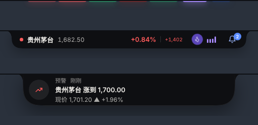
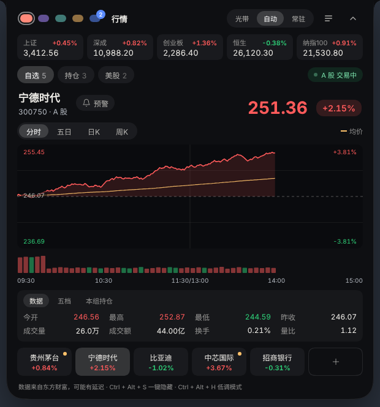

<div align="center">

# Peek Island (余光)

**A "Dynamic Island" for the top of your Windows screen, for keeping an eye on the market.**

Most of the time it is a few-pixel line of light at the top edge. Hover to grow it into an island; click to open a panel.<br>
No pop-up windows, no taskbar button, never steals keyboard focus. Clicks pass straight through to the app underneath when you are not on the island.

[](https://github.com/naolen/peek-island/actions/workflows/build.yml)
[](https://github.com/naolen/peek-island/releases)
[](LICENSE)


[简体中文](README.md) · English

</div>

<p align="center"></p>

<p align="center"></p>

> The UI is in Simplified Chinese. Screenshots use demo data.

## Features

- **Market data** for China A-shares (Shanghai / Shenzhen / Beijing), Hong Kong and US stocks, indexes and ETFs, from Eastmoney with an automatic fallback to Tencent.
  - Groups of up to 8 symbols; scroll on the island to switch groups.
  - Index strip, trading-session status per market, intraday / 5-day / daily K / weekly K charts with MA5 / MA20 and a crosshair, key stats, order book (A-shares).
  - **Alerts**: price above / below, daily change, 5-minute spikes, limit up / down and limit break. Show a card or just make that segment of the light strip glow.
  - **Positions**: quantity and cost basis, today's and total P&L, HKD / USD converted to CNY.
  - **Low-profile mode** (`Ctrl + Alt + H`): greyscale, codes instead of names, no amounts. It can turn on automatically on a schedule. You can also hide the island from screen sharing and screenshots (opt-in).
- **Now playing** for any player that uses Windows media controls (cover art, progress, controls, level meter).
- **Notifications** from Feishu / Lark, QQ, DingTalk, WeCom, Outlook, Teams and others.
- **Mail**: generic IMAP with presets for common providers. Inboxes are read-only, and app passwords are encrypted with DPAPI.
- **Clipboard history** (text and images) and **daily to-dos and notes**.

## Getting started

- **Download** `peek-island-portable-x.y.z.exe` from [Releases](https://github.com/naolen/peek-island/releases) and run it. The installer is not code-signed, so in the SmartScreen prompt choose "More info → Run anyway".
- **Build it yourself**: install Node.js 20+, clone the repo and run `build.bat`. Optionally install the .NET 8 SDK for music and notification support.

```bash
npm install
npm run native   # Windows, optional: builds the C# helper (media, notifications)
npm start
npm test
```

## Privacy

Peek Island only talks to the market data endpoints and the mail servers you configure. It has no telemetry and no uploads. Everything is stored locally in `%APPDATA%/peek-island/`, and notifications are kept in memory only. See [SECURITY.md](SECURITY.md) for details.

## Contributing

Issues and pull requests are welcome. Please read [CONTRIBUTING.md](CONTRIBUTING.md) first. It is written in Chinese, but English issues and PRs are fine.

## Credits

- Market data: Eastmoney and Tencent (unofficial endpoints).
- Some interaction and visual details were inspired by the design notes of [fly-island](https://github.com/flyl1u/fly-island), including the spring open / close, continuous corners and the dock-like page switcher. All code here is written independently.

## License

[MIT](LICENSE) © naolen

This project is not affiliated with any data provider. Market data is for personal reference only and is not investment advice.
