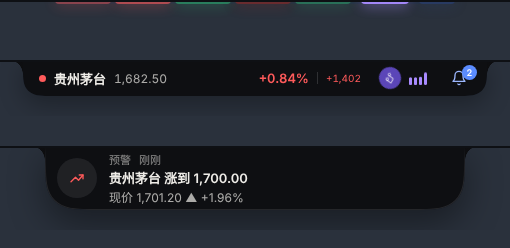
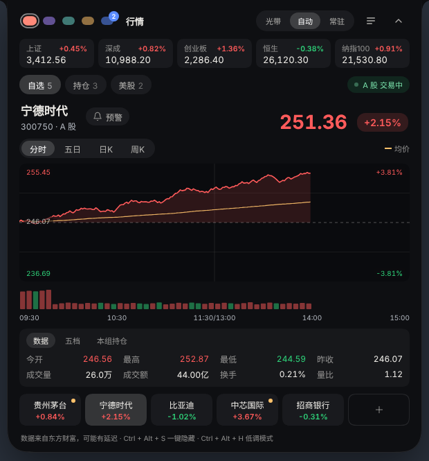
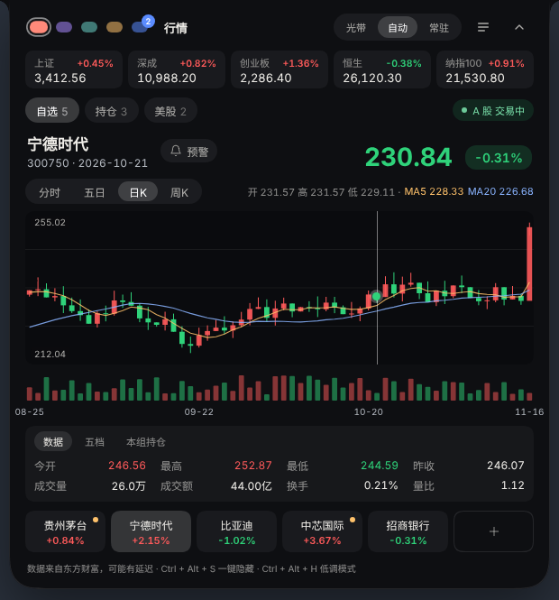
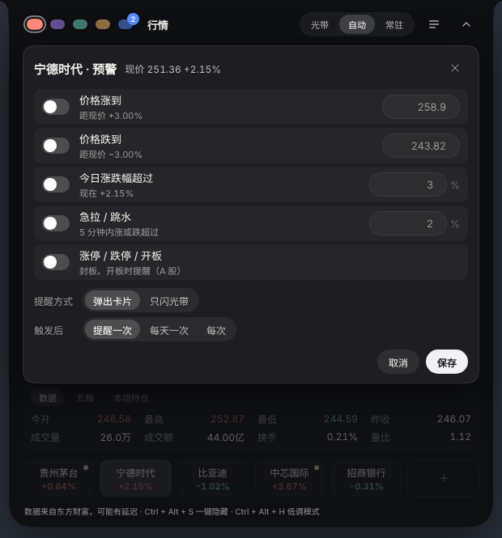
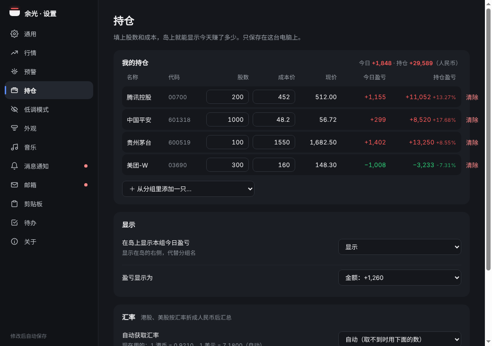
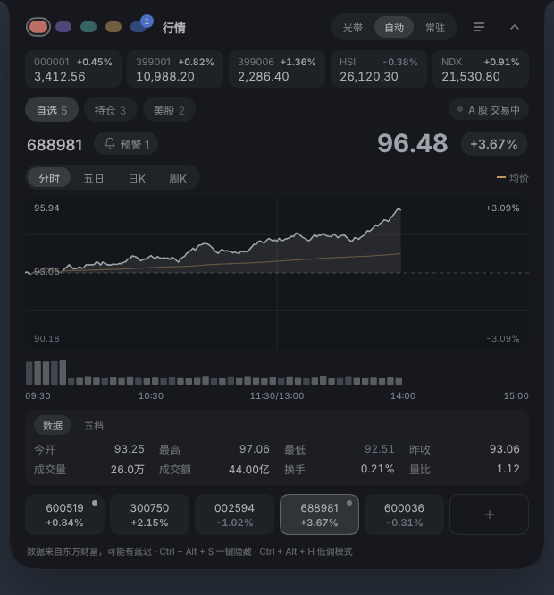
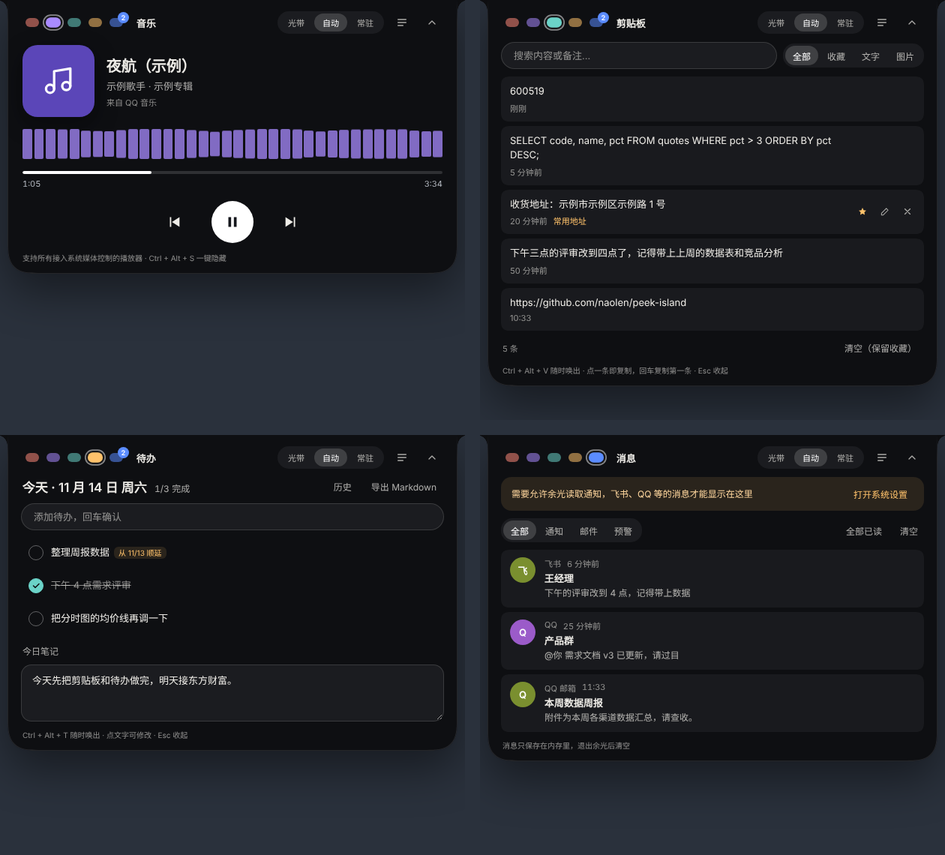

<div align="center">

# 余光 Peek Island

**贴在 Windows 屏幕顶部的“灵动岛”，用余光盯盘。**

平时只是一条几像素高的细光带，鼠标靠近长成岛，点一下展开成面板。<br>
不弹窗、不占任务栏、不抢键盘焦点；没在岛上时，点击直接穿透给下面的软件。

[](https://github.com/naolen/peek-island/actions/workflows/build.yml)
[](https://github.com/naolen/peek-island/releases)
[](LICENSE)


简体中文 · [English](README.en.md)

</div>

<p align="center"></p>

<p align="center"></p>

> 截图里都是演示数据。

能做的事：**股票行情**（分时 / K 线 / 预警 / 持仓盈亏 / 低调模式）、**正在播放的音乐**、**系统通知**（飞书 / QQ / 钉钉等）、**邮箱新邮件**、**剪贴板历史**、**待办与每日笔记**。

## 快速开始

- **直接用**：到 [Releases](https://github.com/naolen/peek-island/releases) 下载 `peek-island-portable-x.y.z.exe`，双击运行。
- **自己打包**：装好 [Node.js](https://nodejs.org/zh-cn) 20+，下载代码后双击 `build.bat`（国内网络用 `build-cn.bat`），详见[在自己电脑上打包](#在自己电脑上打包推荐)。

启动后屏幕顶部正中会出现一条细光。鼠标移上去变成岛，点一下展开；托盘图标右键是菜单，`Ctrl + Alt + S` 一键隐藏。

<details>
<summary>目录</summary>

- [三种形态](#三种形态)
- [行情](#行情) · [预警](#预警) · [持仓盈亏](#持仓盈亏) · [低调模式](#低调模式ctrl--alt--h)
- [音乐](#音乐) · [系统通知](#系统通知) · [邮箱](#邮箱) · [剪贴板历史](#剪贴板历史) · [待办与每日笔记](#待办与每日笔记)
- [外观](#外观) · [快捷键与托盘](#快捷键与托盘) · [内存](#内存)
- [在自己电脑上打包](#在自己电脑上打包推荐) · [下载现成的安装包](#下载现成的安装包) · [本地开发](#本地开发)
- [常见问题](#常见问题) · [数据来源与隐私](#数据来源与隐私) · [参与贡献](#参与贡献) · [致谢](#致谢)

</details>

## 三种形态

| 形态 | 什么时候出现 | 显示什么 |
| --- | --- | --- |
| **光带** | 平时 | 屏幕顶边一条细光。一段对应一只股票（红绿表示涨跌，越亮幅度越大，涨跌超过 3% 会慢慢“呼吸”）；紫色一段是正在播放的音乐；蓝色一段表示有新消息 |
| **岛** | 鼠标移到光带上停 0.15 秒 | 贴顶的黑色半透明岛：左边竖向轮播当前分组的股票，右边是音乐封面和音律条、带未读数的铃铛 |
| **展开** | 点击光带或岛 | 面板分五页：行情 / 音乐 / 剪贴板 / 待办 / 消息 |

另外，来通知或新邮件时，岛会变成一张通知卡片停 5 秒（鼠标停在上面时不收）。

鼠标离开 1.2 秒后自动缩回；正在面板里打字时不会收起，按 Esc 收起。平时停在哪种形态，可以在面板右上角或托盘菜单里切换：

- **光带**：永远只有细光，最隐蔽
- **自动**（默认）：平时光带，鼠标靠近时变成岛
- **常驻**：一直显示岛

第一次启动会弹一张卡片告诉你它在哪。前台有全屏窗口（看视频、打游戏、放幻灯片）时岛会自动藏起来，退出全屏后回来；有多块屏幕时可以在「设置 → 通用」里选显示在哪一块。

## 行情

- 数据来自东方财富，支持 A 股（沪 / 深 / 北交所）、港股、美股、指数、ETF
- 分组：默认自选、持仓、美股、观察，可在设置里新建、改名、排序、删除；每组最多 8 只，一只股票可以放进多个分组；在岛上滚动滚轮切换分组
- 搜索支持代码、拼音首字母、中文名
- 面板顶部是指数条（上证、深成、创业板、恒生、纳指等，设置里可选），点一下就在下面的图里看这个指数
- 交易状态：交易中 / 集合竞价 / 午休 / 已收盘 / 休市，按 A 股、港股、美股各自的时间判断；所有市场都休市时自动降低刷新频率
- 图表：分时（昨收线、均价线）、五日、日 K、周 K（前复权，MA5 / MA20），都带成交量和十字光标
- 图表下面：今开、最高、最低、成交量、成交额、换手、量比；A 股可以看五档盘口
- 股票列表末尾的 **＋**（或按 `/`）：直接在面板里搜索添加，代码、拼音首字母、名称都能搜
- 右键一只股票：设预警、编辑持仓、移到最前、复制代码、移出分组
- 键盘：`←` `→` 换股票，`↑` `↓` 换分组，`1` `2` `3` `4` 切换分时 / 五日 / 日 K / 周 K，`Esc` 收起
- 岛上的分组显示方式：轮播、汇总（涨跌家数 + 平均涨幅）、固定第一只
- 设置里可以拖动给股票排序；分组（连同持仓和预警）可以导出成文件、在另一台电脑导入
- 东方财富连不上时自动改用腾讯行情（只有报价），恢复后切回来；两边都连不上时岛上的数字会变淡，面板底部提示“连接中断”
- 网络请求走 Windows 的系统代理（公司网络要走代理才能上网的也能用）

<p align="center"> </p>

### 预警

- 价格涨到 / 跌到、今日涨跌幅超过、5 分钟急拉 / 跳水、涨停 / 跌停 / 开板（A 股，按主板 10%、创业板 / 科创板 20%、北交所 30%、ST 5% 计算）
- 触发后可以弹出卡片（默认停 6 秒），也可以只让光带上那一段变成琥珀色闪烁，直到你看过为止
- 提醒一次（触发后自动关掉）、每天最多一次、或每次都提醒（离开条件后再满足才算新的一次）
- 只在这只股票的市场交易时判断，收盘后、午休时不会误报；触发记录在「消息 → 预警」里

### 持仓盈亏

- 填股数和成本价，面板上显示今日盈亏、持仓盈亏和占比，岛上显示本组今日盈亏（金额 / 百分比 / 只显示方向）
- 港股、美股按汇率折成人民币汇总；汇率自动获取，取不到时用设置里的数

<p align="center"></p>

### 低调模式（`Ctrl + Alt + H`）

- 不用红绿色、名称换成代码、不显示金额、光带变细变灰、整体更淡
- 可以按时间表自动开启（比如工作日 9:00–18:00）
- 共享屏幕、截图、录屏时岛对别人不可见，自己照常看得到（Windows 10 2004 及以上；默认关闭，在「设置 → 低调模式」里打开）

<p align="center"></p>

## 音乐

<p align="center"></p>

只要播放器接入了 Windows 系统媒体控制（按键盘多媒体键能控制的那些：QQ 音乐、网易云音乐、酷狗、Spotify、浏览器里的视频等），就能显示封面、歌名、进度和跟着音量跳动的波形，并可以上一首 / 播放暂停 / 下一首。暂停 5 分钟后自动从岛上收起。

## 系统通知

读取 Windows 通知中心里的通知（第一次需要在系统设置里允许“通知访问”）。

- 默认提醒飞书、QQ、钉钉、企业微信、Outlook、Teams 和邮件类应用；设置里列出最近发过通知的应用，可逐个勾选，或改成全部应用
- 可以关掉“弹出卡片”，只让光带和铃铛亮起
- 通知内容只保存在内存里，退出后清空

## 邮箱

通用 IMAP，内置常用邮箱的服务器：QQ 邮箱、网易 163 / 126 / yeah.net、Gmail、Outlook / Hotmail、iCloud、Yahoo、新浪、阿里邮箱、腾讯企业邮、网易企业邮、阿里企业邮，其他邮箱可手动填写服务器。

- 填的是邮箱的**授权码 / 应用专用密码**，不是登录密码（设置里每种邮箱都有获取方法的提示）
- 授权码用 Windows 系统加密（DPAPI）保存，只有当前 Windows 用户能解开
- 以只读方式打开收件箱：看邮件不会把它标成已读；只取纯文本，不下载附件、不加载远程图片
- 新邮件会在岛上提醒；点开可以看正文
- 微软已逐步停用 Outlook 个人邮箱的密码登录，可能连接不上

## 剪贴板历史

- 自动记录复制过的文字和图片；搜索、筛选（收藏 / 文字 / 图片）、收藏、备注
- 点一条就复制回剪贴板；在搜索框按回车复制第一条
- `Ctrl + Alt + V` 随时唤出；默认保留 200 条，收藏的不计入、不会被清理
- 保存在 `%APPDATA%/peek-island/clipboard/`

## 待办与每日笔记

- 按天记录待办，没做完的第二天自动顺延（可关闭）；每天一份笔记，自动保存
- 历史里能看到每天的完成情况；可导出当天或全部为 Markdown
- `Ctrl + Alt + T` 随时唤出

## 外观

- **风格**：经典黑 / 液态玻璃（更透，带细亮边）
- **不透明度**：30% ~ 100%，调低后旁人更难注意到
- **大小**：80% ~ 120%
- **离顶边距离**：0 为贴边（两侧带向内凹的圆角，和屏幕顶边连成一体）；大于 0 时变成悬浮的圆角胶囊

## 快捷键与托盘

| 快捷键 | 作用 |
| --- | --- |
| `Ctrl + Alt + S` | 老板键，一键隐藏 / 显示 |
| `Ctrl + Alt + V` | 唤出剪贴板历史 |
| `Ctrl + Alt + T` | 唤出待办 |
| `Ctrl + Alt + H` | 低调模式开 / 关 |

都可以在设置里改；被别的软件占用时，设置里会提示。托盘图标左键隐藏 / 显示，右键菜单里有形态切换、低调模式、配色、剪贴板、待办、设置、开机自动启动、退出。

## 内存

- Electron 本身有一个底（主进程 + 界面 + 网络 + GPU 几个进程），大概 100 多 MB，压不掉；余光尽量不让它越用越涨：图表、五档数据面板收起就丢掉，剪贴板缩略图最多缓存 60 张，邮箱的库只有配了邮箱才加载
- 「设置 → 关于」里能看到当前一共占多少内存
- 「设置 → 通用 → 省内存模式」关掉 GPU 加速，能再省几十 MB，代价是毛玻璃效果没那么顺滑（重启后生效）

## 在自己电脑上打包（推荐）

1. 安装 [Node.js](https://nodejs.org/zh-cn) 20 或更新版本；想要音乐和系统通知的话，再装 [.NET 8 SDK](https://dotnet.microsoft.com/zh-cn/download/dotnet/8.0)（不装也能打包，只是少这两项功能）
2. 下载代码：`git clone https://github.com/naolen/peek-island.git`，或在 GitHub 页面点 Code → Download ZIP 解压
3. 双击仓库里的 **`build.bat`**（国内网络双击 **`build-cn.bat`**，走国内镜像，下载快很多）
4. 打包完成后会自动打开 `dist` 文件夹：
   - `peek-island-portable-x.y.z.exe`：免安装，双击直接运行
   - `peek-island-setup-x.y.z.exe`：安装版

第一次打包要下载依赖，大约 3~10 分钟；之后再打包快很多。

## 下载现成的安装包

到仓库的 **Releases** 下载最新版本，有两个文件，任选其一：

- `peek-island-setup-x.y.z.exe`：安装版，装好后有开始菜单快捷方式，可以开机自启
- `peek-island-portable-x.y.z.exe`：免安装版，双击直接运行，适合先试用（每次启动会先解压，比安装版慢几秒）

每次推送到 main 的构建产物也可以在 **Actions → build → peek-island-windows** 里下载。打 `v*` 标签时会自动发布到 Releases。

安装包没有做代码签名，第一次运行时 Windows SmartScreen 可能会提示“未知发布者”，点“更多信息 → 仍要运行”即可。

## 本地开发

```bash
npm install
npm run native     # （Windows，需要 .NET 8 SDK）编译原生小助手；不编也能跑，只是没有音乐和系统通知
npm start          # 启动
npm run e2e        # 端到端测试：真实的主进程和界面 + 假的行情服务器（Linux 需要 xvfb；Windows 上直接 npx electron scripts/e2e.js）
npm test           # 单元测试（行情解析、交易时段、预警、盈亏、配置、剪贴板 / 待办存储、消息、邮箱——邮箱用本地假 IMAP 服务器测试）
npm run dist       # 在 Windows 上打包 nsis 安装包
npm run smoke      # （Linux，需要 xvfb）用假数据截图检查界面，输出到 ./shots
```

## 目录结构

```
src/
  main.js          主进程：顶部透明置顶窗口、鼠标穿透、托盘、快捷键、各模块的接线
  preload.js       暴露给界面的接口
  config.js        配置读写（%APPDATA%/peek-island/config.json）
  quotes.js        东方财富 / 腾讯接口地址与数据解析（纯函数）
  feed.js          行情网络请求（东方财富失败时自动切到腾讯）
  http.js          发请求用的 fetch：走系统代理、不用缓存
  update.js        检查更新（只在用户点按钮时访问 GitHub）
  session.js       各市场交易时段判断
  alerts.js        预警判断（纯函数）
  pnl.js           持仓盈亏计算（纯函数）
  native.js        启动和管理原生小助手
  clipstore.js     剪贴板历史存储
  clipwatch.js     剪贴板监听
  todostore.js     待办与笔记存储
  inbox.js         消息收件箱（通知 + 邮件），哪些应用要提醒
  mail.js          IMAP 收信
  mailpresets.js   常用邮箱服务器预设、错误说明
  secrets.js       授权码加密保存
  renderer/
    island.*       光带 / 岛 / 展开面板 / 通知卡片
    settings.*     分组与设置窗口
native/PeekNative/ 原生小助手（C#，.NET 8）：媒体会话、音量峰值、系统通知
scripts/           截图自测用的假数据和脚本
test/              单元测试
```

## 常见问题

**行情不刷新 / 显示“行情连接中断”？**
数据来自东方财富的网页接口，公司网络可能拦截。连不上时会自动切到腾讯行情；余光会用 Windows 的系统代理，两个都连不上时请检查系统代理设置。非交易时间每 5 分钟才刷新一次，这是正常的。

**岛不见了？**
按 `Ctrl + Alt + S` 或点托盘图标可以把它叫回来。前台有全屏窗口时它会自动隐藏，不想要可以在「设置 → 通用」里关掉。

**怎么更新？配置会丢吗？**
「设置 → 关于 → 检查更新」，有新版本就去 Releases 下载覆盖安装。配置、剪贴板历史、待办都在 `%APPDATA%/peek-island/`，更新和重装都不会动；换电脑时把这个文件夹整个复制过去就行。

**音乐、系统通知不显示？**
这两项需要原生小助手 `PeekNative.exe`。从 Releases 下载的版本已经带了；自己打包时需要装 .NET 8 SDK，否则会跳过。系统通知还要在「设置 → 隐私和安全性 → 通知」里允许余光读取通知。

**Windows 提示“未知发布者”？**
安装包没有代码签名，点「更多信息 → 仍要运行」即可。介意的话可以自己从源码打包。

**快捷键没反应？**
可能被别的软件占用了。「设置」里对应的快捷键旁会显示“被其他软件占用”，换一个组合即可。

**能用在 macOS / Linux 上吗？**
目前只做了 Windows。界面部分是 Electron，理论上能跑，但贴顶、鼠标穿透、媒体和通知都依赖 Windows。

**会把我的数据传到哪里？**
不会。见[数据来源与隐私](#数据来源与隐私)。

## 排查问题

运行日志在 `%APPDATA%/peek-island/logs/main.log`（超过 1MB 自动清空），「设置 → 关于 → 打开日志位置」可以直接找到。提 Issue 时请附上日志的相关部分（先检查里面没有你不想公开的内容）。

## 数据来源与隐私

- 行情来自东方财富的公开网页接口（`push2.eastmoney.com`、`push2his.eastmoney.com`、`searchapi.eastmoney.com`），连不上时用腾讯（`qt.gtimg.cn`），都是非官方 API，可能有延迟，也可能随时变化。持仓和预警只保存在本机。只有在「设置 → 关于」里点「检查更新」时，才会访问一次 GitHub。仅供个人查看，不构成任何投资建议。
- 原生小助手只读取播放信息、输出音量的峰值和通知内容，不录音、不联网。
- 通知只在内存里；剪贴板、待办、配置保存在本机；邮箱授权码加密保存。除了行情和你配置的邮箱服务器，不向任何地方发送数据。

## 参与贡献

欢迎提 Issue 和 Pull Request。开始之前请看 [CONTRIBUTING.md](CONTRIBUTING.md)，安全问题请按 [SECURITY.md](SECURITY.md) 私下报告。版本变化见 [CHANGELOG.md](CHANGELOG.md)。

## 致谢

- 行情数据：[东方财富](https://www.eastmoney.com/)、[腾讯财经](https://gu.qq.com/)（非官方接口）
- 部分交互和视觉细节（弹簧开合、连续圆角、页面入口的小 Dock 等）参考了 [fly-island](https://github.com/flyl1u/fly-island) 的设计文档，代码为本项目独立实现
- 基于 [Electron](https://www.electronjs.org/)、[ImapFlow](https://github.com/postalsys/imapflow)、[Mailparser](https://github.com/nodemailer/mailparser)

## 许可

[MIT](LICENSE) © naolen

本项目与东方财富、腾讯等数据提供方没有任何关系。行情仅供个人参考，不构成投资建议；据此操作，风险自负。
